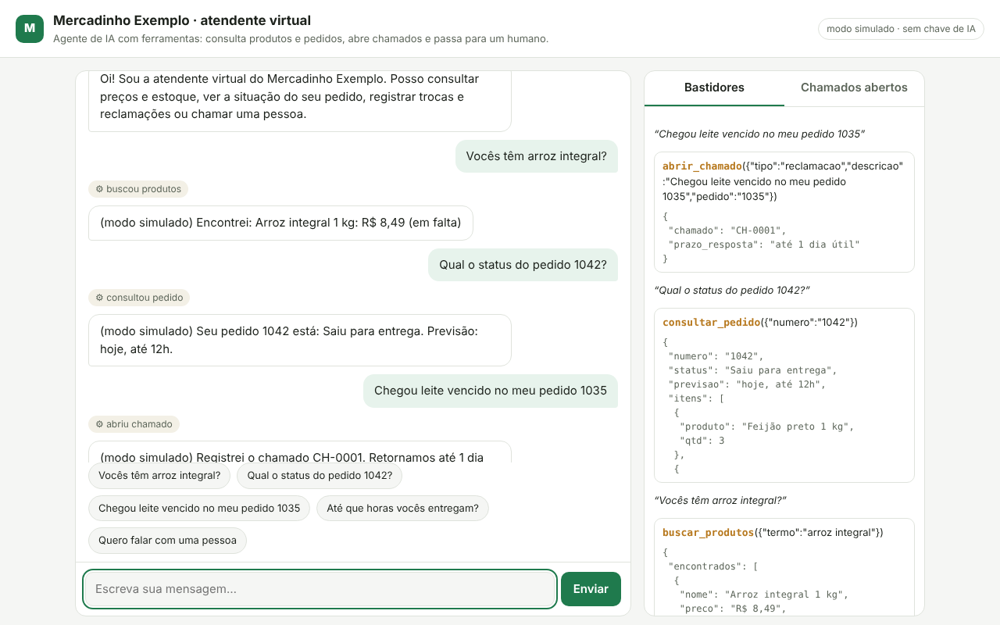

# Agente de atendimento · Mercadinho Exemplo

Atendente virtual para uma loja de bairro fictícia, feita com **Gemini** e **chamada de ferramentas**. O modelo entende o pedido do cliente, decide qual ferramenta usar e responde com base no que ela devolveu, sem inventar preço, estoque ou situação de pedido.

**Demo:** [PREENCHER: link do Render]



## O que ele resolve

| O cliente pede | O agente faz |
|---|---|
| "Vocês têm arroz integral?" | `buscar_produtos` → preço e se está em falta |
| "Qual o status do pedido 1042?" | `consultar_pedido` → situação e previsão de entrega |
| "Chegou leite vencido no pedido 1035" | `abrir_chamado` → registra e informa o número do chamado |
| "Quero falar com uma pessoa" | `transferir_para_humano` → marca a conversa para a equipe |
| "Até que horas vocês entregam?" | responde pelas políticas da loja |

O painel **Bastidores** mostra cada ferramenta chamada, com os argumentos e o resultado. A aba **Chamados abertos** lista o que o agente registrou.

## Como funciona

1. A mensagem chega em `POST /api/chat` com o histórico da conversa.
2. O Gemini recebe as instruções da loja e a descrição das quatro ferramentas.
3. Se ele pede uma ferramenta, o servidor executa sobre os dados locais e devolve o resultado. O laço se repete até a resposta final, com no máximo 5 rodadas.
4. A resposta e os passos voltam para a página.

Decisões:
- **Dados só pelas ferramentas.** As instruções obrigam o modelo a consultar antes de responder sobre preço, estoque ou pedido.
- **Falha não derruba a conversa.** Erro numa ferramenta vira resultado de erro para o modelo; erro do provedor vira aviso na tela.
- **Limites para o plano gratuito.** 25 mensagens por conversa, 300 por dia e histórico curto.
- **Modo simulado.** Sem `GEMINI_API_KEY`, regras simples imitam o modelo, e a página e os testes funcionam sem chave.

## Rodar localmente

```bash
pip install -r requirements.txt
export GEMINI_API_KEY=...   # chave gratuita do Google AI Studio; sem ela, roda no modo simulado
uvicorn app.main:app --reload
```

Testes: `pip install pytest httpx && pytest`

## Publicar no Render

Novo Blueprint apontando para este repositório (`render.yaml`). No painel, preencha `GEMINI_API_KEY`.

## Stack

Python, FastAPI, Gemini (SDK `google-genai`), HTML/CSS/JS sem framework, pytest, Render.

---
Loja, produtos, pedidos e clientes são fictícios.
